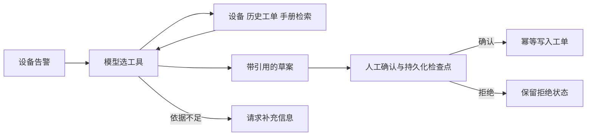

# 设备告警处置 Agent 与工单工作流

基于 LangGraph 官方 ReAct 模板改造的个人 FDE 项目。输入设备告警，Agent 查询设备、历史工单和维护手册，形成有出处的检查草案；操作者确认后，工作流写入本地工单库。

本项目在 AI 辅助下开发，完成本地单进程 POC。数据为构造的演示设备、手册和工单。上游版本、许可与增量见 [UPSTREAM.md](UPSTREAM.md)，交付与故障排查见 [docs/delivery.md](docs/delivery.md)。

## 已运行的结果

- 24 项本地回归通过，覆盖中文检索、引用与设备范围、审批、重复事件、重启、接口和失败状态。
- 真实 DeepSeek `deepseek-flash` 三个指定样例符合预期：确认后写入、拒绝后不写、依据不足返回待补信息。见 [实际接口记录](reports/live-verification.json)。
- 真实本地 HTTP 联调通过，包含重复事件复用运行、待审批不写入与报告查看。见 [HTTP记录](reports/http-smoke.json)。
- 样例结果只描述本地 POC；实际工业客户、MES/ERP 接入与生产运行不属于本次完成范围。

## 技术与工作流

Python 3.11+、LangGraph、DeepSeek API、FastAPI、Pydantic、SQLite FTS5/BM25、SqliteSaver。



工具清单：`query_device`、`query_work_orders`、`search_manual`、`draft_work_order`。模型自主选工具和参数；固定图结构负责审批、状态和写入。

手册检索使用中文重叠二元词组和 FTS5/BM25。返回的片段带原文、ID、来源和版本。草案只接受当前运行真正检索过、且属于当前设备类型的引用。引用校验与语义判断分别处理。

## Windows 本地启动

```powershell
git clone https://github.com/GuoJianFei666/fde-maintenance-agent.git
Set-Location fde-maintenance-agent
py -3 -m venv .venv
& .venvScriptspython.exe -m pip install -e '.[dev]'
Copy-Item .env.example .env
# 在本地 .env 填写 DEEPSEEK_API_KEY；不要提交该文件。
& .venvScriptspython.exe -m uvicorn react_agent.api:create_app --factory --host 127.0.0.1 --port 8765 --workers 1
```

打开 <http://127.0.0.1:8765/docs> 交互操作 API。仅配置 DeepSeek 密钥即可，模型名默认 `deepseek-flash`；可通过 `.env` 调整接口、模型、超时和最大轮数。完整固定依赖另存于 `requirements-lock.txt`。

## 演示请求

在 `/api/alarms` 提交：

```json
{
  "event_id": "demo-pump-001",
  "device_id": "P-101",
  "message": "循环泵振动升高并伴随轴承异响，请查手册和历史工单后生成检查草案。",
  "severity": "warning"
}
```

结果为 `awaiting_approval` 时，查看 `proposal` 和 `report.evidence`。把 `report.proposal_sha256` 与运行编号用于 `/api/runs/{run_id}/approval`，提交 `approved: true` 或 `false`。工单写入只发生在确认分支；草案哈希不匹配返回409。

同号同内容的事件返回原运行；同号不同内容返回409。重启时保留同一 `OPS_DATA_DIR`，即可继续处理待审批运行。默认运行状态在 `runtime/`，与本地密钥一起排除出 Git。

CLI 也支持相同流程：

```powershell
& .venvScriptspython.exe -m react_agent.cli diagnose --event cli-001 --device P-101 --message '循环泵振动升高，请生成检查草案'
# 阅读输出，复制 run_id 及 proposal_sha256 后再执行：
& .venvScriptspython.exe -m react_agent.cli decide '<run_id>' --decision approve --proposal-hash '<proposal_sha256>'
& .venvScriptspython.exe -m react_agent.cli report '<run_id>' --out runtime
eport.md
```

## 检查与真实模型验收

```powershell
& .venvScriptspython.exe -m ruff check src tests scripts
& .venvScriptspython.exe -m pytest -q --junitxml=reportslocal-tests.xml
# 以下命令会调用本地配置的 DeepSeek，产生该账号的 API 用量：
& .venvScriptspython.exe scriptserify_live.py --out runtimemy-live-verification.json
# 先启动本地服务，再检查真实 HTTP：
& .venvScriptspython.exe scriptserify_http.py
```

回归使用 `scripted_test` 模型替身，生产 API 和 CLI 只选择真实 DeepSeek。未配置密钥返回503，供应商失败返回502；失败状态和错误类别保留在运行记录。CI 运行回归和静态检查，无需真实模型密钥。

## 文件导读

| 文件 | 职责 |
|---|---|
| `src/react_agent/graph.py` | 模型与工具循环、人工确认、工单写入节点 |
| `src/react_agent/tools.py` | 4类工具输入和业务约束 |
| `src/react_agent/store.py` | 演示业务数据、手册检索、事件去重与工单幂等 |
| `src/react_agent/llm.py` | DeepSeek Tool Calls 接入与实际用量 |
| `src/react_agent/service.py` | 持久化运行、审批恢复、轨迹与报告 |
| `src/react_agent/api.py` | REST接口和交互文档 |
| `tests/` | 明确区分模型替身的回归检查 |
| `reports/` | 本次实际验证记录和样例报告 |
| `docs/resume-and-interview.md` | 真实项目正文、源码讲解及面试参考 |

没有实测的生产指标不填数字。后续进入真实业务时，应单独确认数据、接口权限、验收场景与部署条件。
