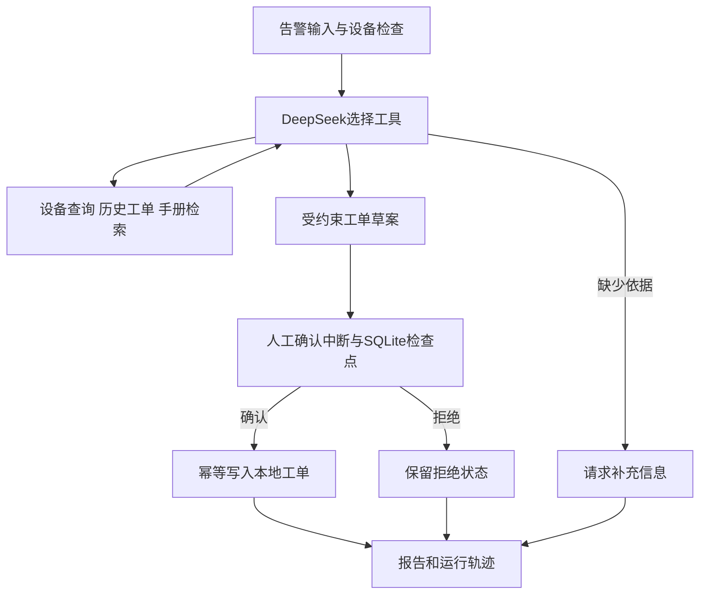

# 设备告警处置项目交付说明

## 业务范围与验收

接收一条设备告警，查询设备档案和历史工单，检索维护手册，输出带来源的检查工单草案。由操作者查看草案后确认或拒绝；确认才写入本地工单库。设备、知识和历史工单均是项目构造的演示材料。当前完成本地POC，实际工厂的MES、ERP及设备控制接口不在已完成范围。

| 验收点 | 实现位置 | 可观察结果 |
|---|---|---|
| 模型自主选择查询和草案工具 | graph.py、tools.py、llm.py | trace中的工具名、参数、返回值和耗时 |
| 有来源的知识检索 | store.py | 中文二元词组、SQLite FTS5/BM25排序、原文与版本 |
| 引用约束 | tools.py | 草案只接受本次已检索且适配设备类型的证据ID |
| 人工确认 | graph.py | awaiting_approval时没有新工单，确认后completed |
| 审批后写入及重复处理 | service.py、store.py | event_id绑定输入；同一运行仅写一个工单 |
| 重启后继续待审批任务 | SqliteSaver与thread_id | 重建服务后审批，不再调用模型 |
| 信息不足与系统失败 | graph.py、api.py | needs_information、failed和502/503各自保留 |
| 过程交付 | service.py、API | Markdown报告、原句、Prompt/语料版本、实际模型用量 |

## 输入输出

告警输入：event_id、device_id、message、severity。event_id是来源事件号，相同事件相同内容返回原运行；同号不同内容返回409。

草案输出：summary、priority、checks、rationale、evidence_ids。审批请求携带approved和proposal_sha256。后者绑定操作者看到的草案，过期或不匹配的确认返回409。

运行状态：running → awaiting_approval → completed/rejected。没有足够材料形成草案时为needs_information；API错误、执行错误或轮数耗尽为failed。

## 工作流

Agent决定调用哪个只读工具和草案工具，固定工作流负责确认和数据库写入。工具列表中没有直接创建工单或操作设备的函数。

## 故障排查

| 现象 | 查看位置 | 处理 |
|---|---|---|
| 503 model_not_configured | 本地.env的配置状态 | 配置DEEPSEEK_API_KEY；不显示或上传其值 |
| 502 model_call_failed | 运行轨迹的错误类别 | 核对模型名、账号额度和网络；保留失败记录 |
| 工具ok=false | trace的error_code | 检查参数、设备范围、检索来源和调用顺序 |
| needs_information | answer和检索结果 | 补充手册或告警信息，不将其改称已解决 |
| 409 | 请求事件或草案哈希 | 使用不同的新事件号，或重新查看当前草案 |
| 重启后找不到任务 | OPS_DATA_DIR、运行编号 | 确保使用同一个runtime目录及run_id |

运行在本机127.0.0.1、单进程。公开网络服务需要在另一个部署任务中增加访问控制和明确的业务接口授权。

## 实测记录与复查

- tests/使用明确标记的scripted_test模型替身验证状态与接口约束，避免把API波动混入回归测试。
- scripts/verify_live.py明确调用本地配置的DeepSeek，结果写入reports/live-verification.json；验收脚本的审批动作标为acceptance_script。
- scripts/verify_http.py通过真实HTTP访问已启动服务，留一条待人工确认的告警供演示。
- 具体状态、调用次数、tokens和耗时以reports/中的实际记录为准。这些是选定本地样例的结果，不代表生产准确率、可用性或客户收益。
