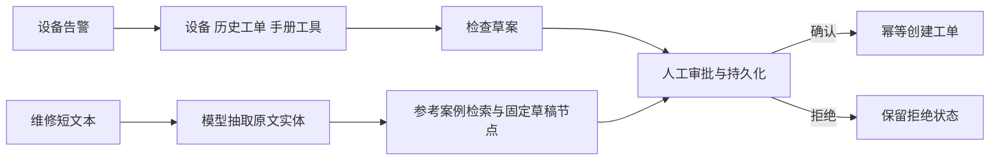

# 设备告警与维修文本受理 Agent：技术说明

本项目把设备告警和维修短文本转换为可审阅草稿，经人工确认后写入工单。已有两条可运行流程，当前交付为 Windows 本地单进程 POC。设备、演示手册与初始工单为合成材料；维修短文本来自公开 MaintIE。

完整源码、启动入口与 API 示例见[项目首页](../../README.md)。本目录补充技术解释和独立数据检查。

## 技术栈与工作流

| 技术 | 具体职责 |
|---|---|
| Python、LangGraph | 组织 ReAct 告警流程、固定受理节点及人工确认 |
| DeepSeek API | 业务工具选择、告警分析和维修文本实体抽取 |
| FastAPI、Pydantic | REST 接口及输入、输出结构校验 |
| SQLite FTS5 / BM25 | 手册与参考案例检索；中文检索使用重叠双字及关键词别名 |
| SqliteSaver | 持久化流程检查点，支持重建服务后继续审批 |



告警路径提供 `query_device`、`query_work_orders`、`search_manual`、`draft_work_order`。文本路径以一次 `submit_extraction` 工具调用抽取实体，之后由固定节点执行检索、缺项检查和草稿生成。模型输出需要通过 token 跨度与原文一致性校验。

## 可靠性设计

- **人工确认。** 审批绑定 `run_id` 与草案 SHA256，避免确认过期或被替换的内容。
- **幂等写入。** 同一事件同内容复用已有运行；同号不同内容返回 409。重复确认不会重复创建工单。
- **流程恢复。** 检查点与业务运行持久化，在保持同一数据目录时，可重建服务后继续审批。
- **检索隔离。** MaintIE 的 869 条参考数据进入案例范围；207 条评价记录不进入检索索引。案例是参考文本，不作为真实设备履历。
- **失败保留。** 信息不足、模型或供应商错误、拒绝、待审批及创建成功分别记录；缺少密钥为 503，供应商或协议错误为 502。

## 实际结果

| 项目 | 已有记录 |
|---|---|
| 真实模型抽取 | 固定 24 条评价文本，TP=62、FP=17、FN=12；严格跨度与顶层类别 micro-F1=0.8105 |
| 单条完全一致 | 24 条中 9 条实体集合完全一致；结构校验通过不等于语义全对 |
| 流程验收 | 确认创建 1 单；拒绝及信息不足各创建 0 单；重建服务后可审批，重复确认不重复创建 |
| 回归与接口 | 已有 44 项本地回归和本机 TCP/HTTP 记录，见项目现有 tests 与 reports |

上述模型指标仅针对 PhysicalObject、State、Process、Activity、Property 五种顶层实体，不代表细粒度类别、关系抽取或工单解决率。本轮只增补公开说明和数据检查，未重新调用模型或运行原项目。

## 使用方法

按[项目首页的 Windows 本地启动步骤](../../README.md#windows-本地启动)安装并配置本地 `DEEPSEEK_API_KEY`，使用单 worker 启动 FastAPI，打开 `http://127.0.0.1:8766/docs`。

1. 向 `POST /api/maintenance-texts` 提交 `event_id`、`device_id`、`message` 与 `severity`；可附 `source_record_id`。附带公开记录 ID 时，文本必须与对应原文一致。
2. 查看返回的 `proposal`、`report.text_extraction`、`report.evidence` 与来源。真实设备映射由操作者提供。
3. 在 `awaiting_approval` 状态下，将当前 `run_id` 与 `report.proposal_sha256` 用于 `POST /api/runs/{run_id}/approval`，确认或拒绝草案。
4. 通过 `/api/runs/{run_id}/trace` 和 `/report` 查看节点轨迹、模型与报告。

只读数据入口为 `GET /api/datasets/maintie`、`GET /api/cases/search?q=泵漏油` 和 `GET /api/cases/{case_id}`。CLI 同样支持 dataset、cases、intake、report，具体参数见项目首页。

原项目尚未连接真实 MES/ERP 或设备控制系统。这里的完成结果是本地受理与审批链路。

## 本仓库的数据检查

在 Windows PowerShell 中进入本目录后运行。该工具只下载并检查本项目的固定公开数据，不运行模型或应用：

```powershell
py -3 tools/inspect_public_data.py --download --cache .cache --output reports/inspection-results.json
```

已有缓存时可省略 `--download`。输出为数据结构统计和逐文件哈希，详见[检查记录](docs/DATA-INSPECTION.md)。


## 参考

[MaintIE](https://github.com/nlp-tlp/maintie/tree/825e7710e4129598da997276a38b3cb40b200bc2)、[LangGraph ReAct template](https://github.com/langchain-ai/react-agent/tree/087d90d0c876668956b733a104f1708cef0128e2)。版本与许可见[简要来源](docs/SOURCES.md)及 [data/sources.json](data/sources.json)。项目技术说明与公开数据各自保留记录。
